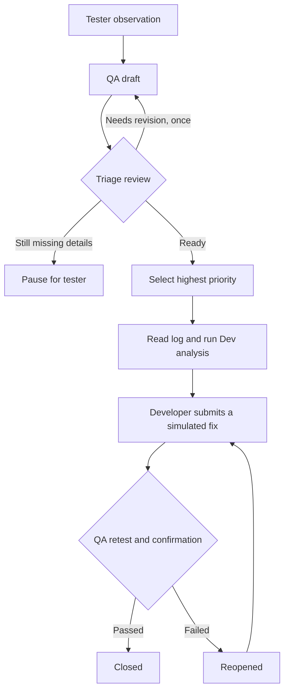

# Defect Lifecycle Assistant

QA testers can turn observations into structured defect reports, prioritize work, and verify the disposition of a defect after a developer submits a fix. The demo uses a synthetic mobile transfer and a cosmetic issue. Each agent has a focused task and the Python workflow controls handoffs.

## Architecture

| Agent | Responsibility |
|---|---|
| QA | Drafts or revises the defect from the tester observation |
| Triage | Checks completeness and evidential support, classifies the defect, and assigns P1, P2, or P3 with a reason |
| Dev | Reads the selected report and its local evidence, then proposes a hypothesis and a verification step |



The one-revision reflection loop hands Triage feedback back to QA. Python validates Triage's output and selects the highest priority among ready defects. The synthetic transfer retest executes a Python simulation and compares the request version with the saved version. QA must confirm the final status. The transfer log and simulation apply to DEF-01. DEF-02 demonstrates classification and priority.

## Project structure

- `main.py` contains the workflow, Groq integration, guardrails, and simulator.
- `transfer.log` is the synthetic evidence read by the Dev step.
- `test_workflow.py` contains offline tests.
- `requirements.txt` lists the Groq Python SDK.
- `workflow.log` is generated at runtime and contains timestamps, agent stages, routing, file outcomes, and retest results.

## Setup and run

Use Python 3.10 or newer. From the project folder in VS Code or PowerShell:

```powershell
py -m venv .venv
.\.venv\Scripts\python.exe -m pip install -r requirements.txt
.\.venv\Scripts\python.exe main.py
```

Paste the Groq API key at the hidden prompt, or set `GROQ_API_KEY` in your environment. The default model is `openai/gpt-oss-20b`. The optional `GROQ_MODEL` variable overrides it. Use synthetic data in the demo.

At the Dev prompt, enter `incomplete`. Press Enter to retest, then confirm with `yes` to reopen. At the next Dev prompt, enter `fixed`. Press Enter to retest, then confirm with `yes` to close the same defect.

## Offline demo and testing

```powershell
.\.venv\Scripts\python.exe main.py --offline
.\.venv\Scripts\python.exe main.py --offline --incomplete-report
.\.venv\Scripts\python.exe -m unittest -v
```

Offline mode uses deterministic agent responses and intentionally starts the UI defect with an incomplete draft to demonstrate the reflection loop. Live model language and triage decisions can vary.

## Security and monitoring

The workflow validates model responses before routing. It masks matching identifiers and email addresses, blocks a basic instruction-override pattern, and requires explicit QA confirmation before closing or reopening. The pattern filter has limited coverage. The execution log records stage names and outcomes without keys, prompts, or raw transfer logs.

## Future improvements

Add persistent defect history, an interactive clarification form, a UI, and an integration with a defect tracker. Add more synthetic transfer tests covering other failure modes.
